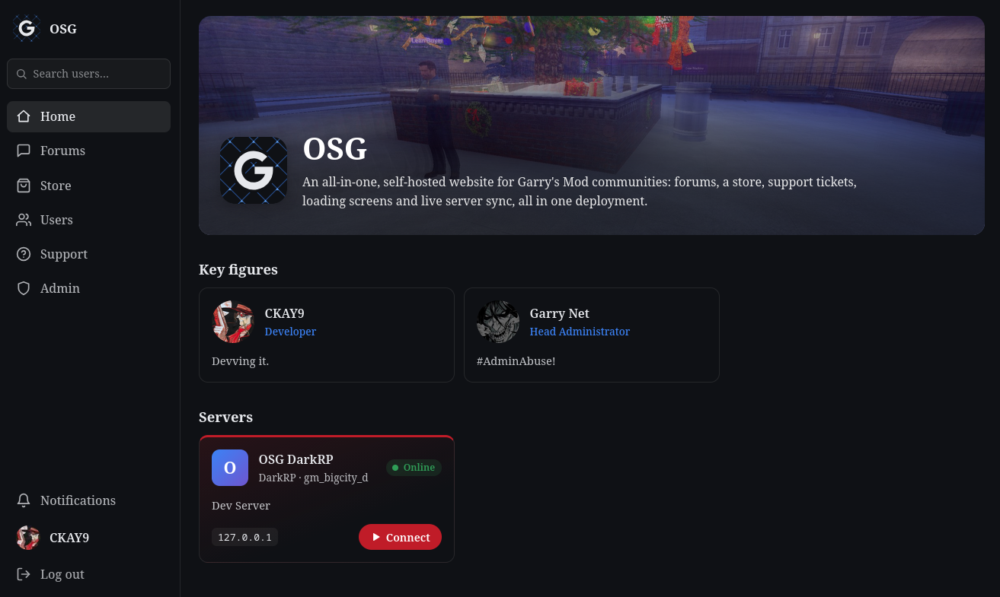
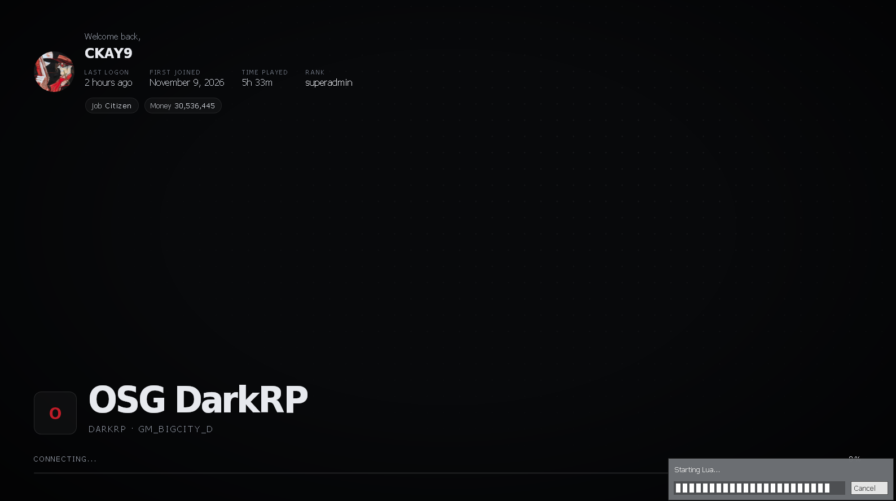
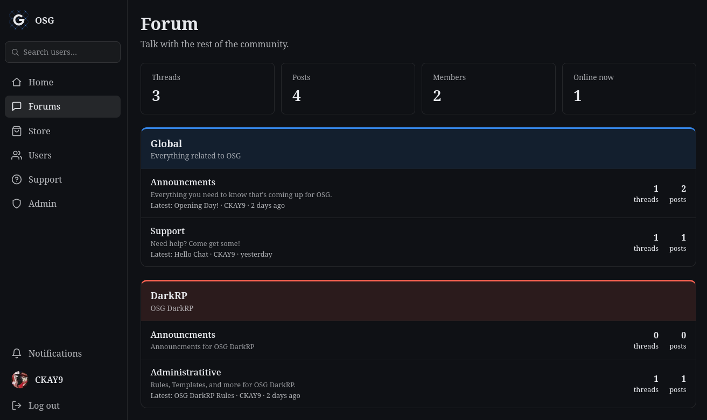
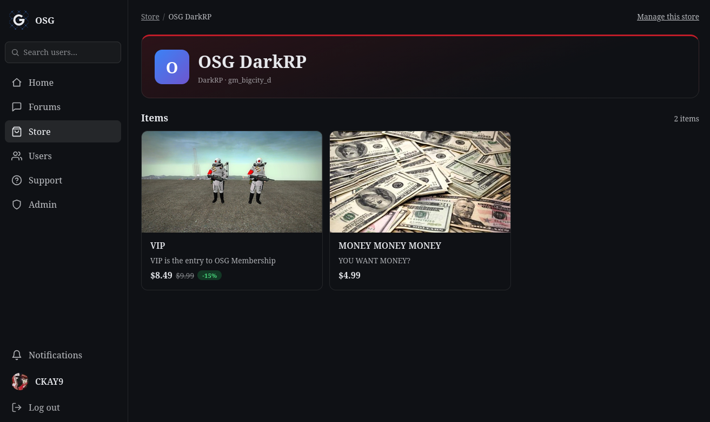
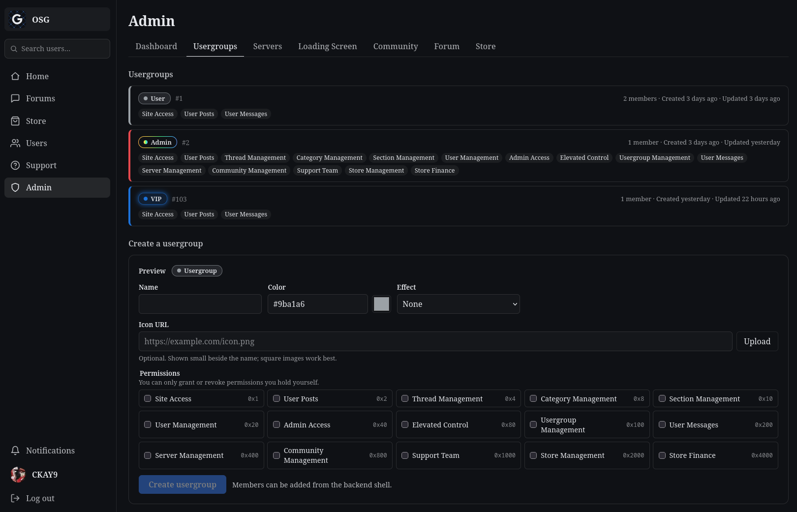

<div align="center">
    
    <br><br>
    <h1>GarryNet</h1>
    <p>An all-in-one, self-hosted website for Garry's Mod communities: forums, a store, support tickets, loading screens and live server sync, all in one deployment.</p>
</div>

<p align="center">
    
</p>

> [!NOTE]
> GarryNet is under active development. The features below work, but expect breaking changes between versions.

## Features

### Community Homepage

One deployment per community. A homepage with your name, logo, splash image, external links, key figures and your servers (with `steam://` connect links). Everything is editable from the admin dashboard.

### Loading Screen

A loading screen for your Garry's Mod servers, in two styles (Aero and Sleek). It greets each player by name and avatar, shows their first join and last visit on that server, and follows Garry's Mod's download progress.

<p align="center">
    
</p>

### Forums

Sections, categories and threads with Markdown posts, attachments, likes/dislikes and user reputation. Moderators can lock, sticky, edit and delete.

<p align="center">
    
</p>

### Support

Support tickets with categories, internal staff notes and attachments, plus an FAQ. Users banned from the site can still open tickets.

### Store

Sell in-game rewards per server: usergroups (permanent or timed), weapons and DarkRP money. Payments go through Stripe Checkout, with discounts, stock limits, receipts and refunds. The addon delivers purchases in-game automatically, and refunds take usergroups and weapons back.

<p align="center">
    
</p>

### Users and Permissions

Steam login, profiles with bios and their threads and posts, private profiles, online status and user search. Usergroups have permission bits and custom colors, icons and effects. Staff can ban users (support only) or suspend them (no posting) from their profile, permanently or for a set time, and optionally keep banned users off your game servers.

<p align="center">
    
</p>

### Servers and Players

Register servers on the website and link them with a one-time access key. The site shows each server's status, gamemode and map. The addon syncs per-server player records every minute: playtime, last seen and gamemode stats such as DarkRP money and job. It can also refuse players banned on the website.

### Legal Pages

Terms of service, a privacy policy and a refund policy, linked from every page, the login button and the store. GarryNet fills them with templates based on what it actually stores, and you edit them from the admin dashboard. The templates are a starting point, not legal advice.

### Notifications

In-site notifications for ticket replies, purchases and deliveries, forum replies, private messages, usergroup changes, and bans and suspensions.

### Private Messages

Users with the `User Messages` permission can message each other with Markdown and up to 3 attachments. Messages can be set to disappear after 24 hours, and either user can delete a chat from their own side. Messages aren't private from staff, who can read them from the admin dashboard.

## How It Fits Together

```
 Browser ──► Frontend (Next.js) ──► Backend (Rust, Actix Web) ──► PostgreSQL
    │                                   ▲   ▲   │
    └── Steam login, uploads ───────────┘   │   └──► Stripe, S3 (optional)
                                            │
 Garry's Mod server (GarryNet addon) ───────┘  heartbeat, store delivery
```

- **Backend** (`backend/`): the API. Steam login, permissions, forums, store, Stripe webhooks, file storage, and the routes the addon calls. Database migrations are applied on startup.
- **Frontend** (`frontend/`): the website and the loading screen. It talks to the backend server-side, and the browser talks to the backend directly for login and uploads.
- **Addon** (`addon/`): a Garry's Mod server addon. It links the server, reports players every minute and delivers store purchases.

Both the browser and your Garry's Mod servers must be able to reach the backend, so it needs a public URL (e.g. `https://api.example.com`).

## Requirements

- A [Steam Web API key](https://steamcommunity.com/dev/apikey)
- **Docker** with Docker Compose, **or** PostgreSQL 17, Rust 1.85+ and Node.js 22
- A domain with HTTPS for production (a reverse proxy such as Caddy or nginx in front of the frontend and backend)
- Optional: a [Stripe](https://stripe.com) account, to take payments in the store
- Optional: an S3-compatible bucket (AWS S3, Cloudflare R2, MinIO) for uploads; local disk is the default

## Deployment

### Docker (recommended)

1. **Clone** the repository onto your web server:
    ```sh
    git clone https://github.com/CKAY-9/garrynet.git
    cd garrynet
    ```
2. **Configure the backend.** Copy `backend/.env.example` to `backend/.env` and set:
    - `BACKEND_URL`: the backend's public URL, e.g. `https://api.example.com`. Steam login returns here.
    - `FRONTEND_URL`: the website's public URL, e.g. `https://example.com`.
    - `JWT_SECRET`: a long random string, e.g. from `openssl rand -base64 48`.
    - `STEAM_API_KEY`: your Steam Web API key.
    - `COOKIE_DOMAIN`: needed when the site and backend are on different subdomains. For `example.com` and `api.example.com`, set it to `example.com`.

    `DATABASE_URL` and `BIND_ADDR` are set by Compose, so you can leave them alone.
3. **Configure the frontend.** Copy `frontend/.env.example` to `frontend/.env` and set `NEXT_PUBLIC_API_URL` to the backend's public URL (the same as `BACKEND_URL`). `API_URL` is set by Compose.
4. **Set a database password.** Create a `.env` in the repository root:
    ```sh
    POSTGRES_PASSWORD=<a strong password>
    ```
    Without it the password defaults to `garrynet`. You can also set `POSTGRES_USER`, `POSTGRES_DB`, `BACKEND_PORT` (default 8080) and `FRONTEND_PORT` (default 3000) here.
5. **Start it:**
    ```sh
    docker compose up -d --build
    ```
    The frontend listens on port 3000 and the backend on 8080. Point your reverse proxy at them.
6. **Make yourself an admin.** Log in on the website with Steam once, then:
    ```sh
    docker compose exec backend backend usergroup add <your SteamID64> admin
    ```
    Reload the page and the Admin section appears in the navigation.

`NEXT_PUBLIC_API_URL` is baked into the frontend at build time, so re-run with `--build` after changing it. Uploaded files are kept in the `uploads` volume, and the database in `db-data`.

### Manual

The backend and frontend are separate processes; start the backend first.

**Backend**

1. Create a PostgreSQL database.
2. Copy `backend/.env.example` to `backend/.env` and set `DATABASE_URL`, plus the variables from step 2 of the Docker setup.
3. In `backend/`, run `cargo run --release`. Migrations are applied on startup.

**Frontend**

1. Copy `frontend/.env.example` to `frontend/.env`. Set `NEXT_PUBLIC_API_URL` to the backend's public URL and `API_URL` to an address the frontend server can reach it on (e.g. `http://localhost:8080`).
2. In `frontend/`, run `npm ci && npm run build && npm start`.

Then make yourself an admin. Log in once, and in `backend/` run `cargo run --release -- usergroup add <your SteamID64> admin`.

### Updating

```sh
git pull
docker compose up -d --build
```

Database migrations run automatically when the backend starts. Back up the `db-data` volume before updating.

## Connecting a Garry's Mod Server

1. **Install the addon.** Copy the `addon/` folder to your server as `garrysmod/addons/garrynet`.
2. **Point it at the backend.** Add this to `garrysmod/cfg/server.cfg`, using the backend's public URL (`BACKEND_URL`):
    ```
    garrynet_api_url "https://api.example.com"
    ```
    Garry's Mod blocks HTTP requests to local and private addresses. If the backend runs on the same machine or network (common when testing), start the server with `-allowlocalhttp`.
3. **Register the server.** On the website, go to **Admin → Servers → Register** and copy the access key. It is only shown once.
4. **Link it.** Restart the Garry's Mod server, join as a superadmin, type `!gnet` in chat and paste the key. (From the server console: `garrynet_link <key>`.) Superadmins get a chat message once the server is linked, and the website shows it as **Online** within a minute.
5. **Set up the loading screen** (optional). The server's admin page shows its `sv_loadingurl` line. Add it to `server.cfg`:
    ```
    sv_loadingurl "https://example.com/loading-screen?server=<SERVER_ID>&steamid=%s&mapname=%m"
    ```

If the server and website fall out of sync (for example, the server was unlinked on the website), regenerate the access key and link again. Store usergroups are granted through ULX when it's installed. See [addon/README.md](./addon/README.md) for console commands and store delivery details.

## Store Payments (Stripe)

The store can be browsed and managed without Stripe, but nothing can be bought until both keys are set in `backend/.env`:

1. `STRIPE_SECRET_KEY`: from the [Stripe dashboard](https://dashboard.stripe.com/apikeys) (`sk_live_...`, or `sk_test_...` for testing).
2. Create a webhook endpoint at `<BACKEND_URL>/stripe/webhook` subscribed to these events, and put its signing secret in `STRIPE_WEBHOOK_SECRET`:
    - `checkout.session.completed`
    - `checkout.session.async_payment_succeeded`
    - `checkout.session.async_payment_failed`
    - `checkout.session.expired`
    - `charge.refunded`
    - `charge.dispute.created`
    - `charge.dispute.closed`

Stripe Tax is optional (`STRIPE_TAX`). See [docs/STORE.md](./docs/STORE.md) for stores, items, rewards and refunds.

## Administration

Most management happens in the website's **Admin** section, which you can reach once you're in a usergroup with Admin Access. The backend also has a small command shell for when you're locked out or bootstrapping:

```sh
backend usergroup list
backend usergroup add <USER_ID or SteamID64> <GROUP>
backend usergroup remove <USER_ID or SteamID64> <GROUP>
backend user show <USER_ID or SteamID64>
backend user unban <USER_ID or SteamID64>
backend user unsuspend <USER_ID or SteamID64>
backend help
```

With Docker, prefix these with `docker compose exec backend`. You can also type the commands, without the `backend` prefix, straight into a running backend's terminal:

- **Docker:** run `docker compose attach backend` and type commands such as `usergroup list`. Detach with **Ctrl+P, Ctrl+Q**. Ctrl+C stops the backend, which restarts automatically.
- **Manual:** type them into the terminal running `cargo run`.

Command output and the server's logs appear in the same terminal. See [docs/PERMISSIONS.md](./docs/PERMISSIONS.md) for the permission bits.

## Development

Run the backend and frontend in development mode:

```sh
# Terminal 1: needs a local PostgreSQL and backend/.env
cd backend && cargo run

# Terminal 2
cd frontend && npm install && npm run dev
```

- **Stripe:** forward webhooks to your local backend with `stripe listen --forward-to localhost:8080/stripe/webhook`, and use the `whsec_...` it prints as `STRIPE_WEBHOOK_SECRET`.
- **Garry's Mod:** run a local server with `-allowlocalhttp` and symlink `addon/` into its `addons` folder.
- **S3:** [docs/STORAGE.md](./docs/STORAGE.md#testing-with-a-local-s3-garage) shows how to test the S3 provider against a local Garage container.
- **Checks:** `cargo test` in `backend/`, `npm run lint` in `frontend/`.

The design docs describe every feature, its data model and its API routes. Start at [docs/README.md](./docs/README.md).

### Project Layout

```
addon/      Garry's Mod addon (GLua)
assets/     Logo and images for this README
backend/    API server (Rust, Actix Web, sqlx); migrations in backend/migrations
docs/       Design docs: data models, routes, permissions, behavior
frontend/   Website and loading screen (Next.js, TypeScript)
```

## Contributing

Issues and pull requests are welcome. Before working on something large, please open an issue to discuss it. Read the relevant doc in [docs/](./docs/README.md) first, and update it if your change affects behavior or routes.

## Security

Please don't report vulnerabilities in public issues. See [SECURITY.md](./SECURITY.md).

## License

[MIT](./LICENSE)
